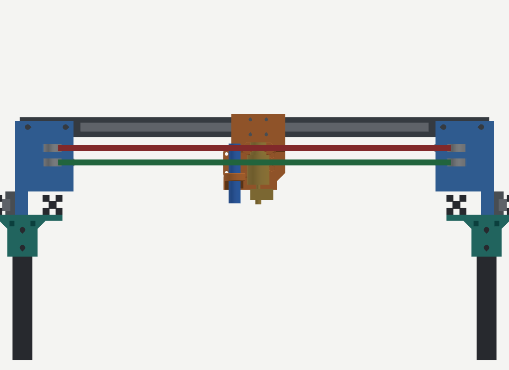
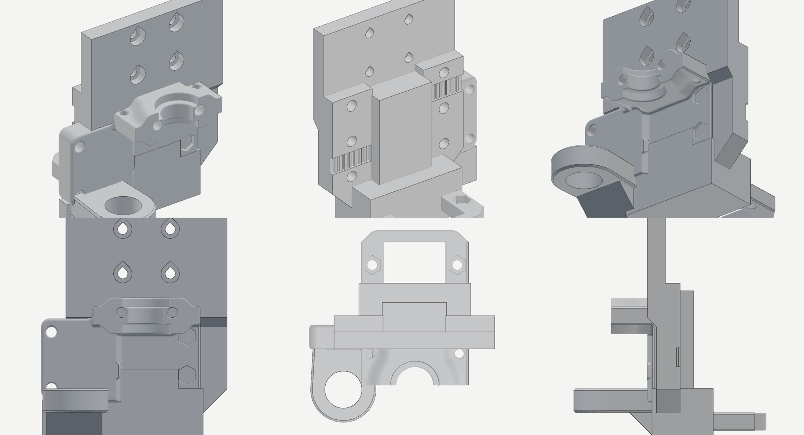
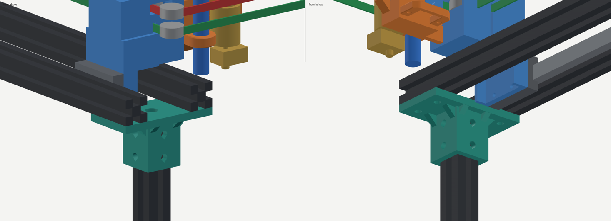
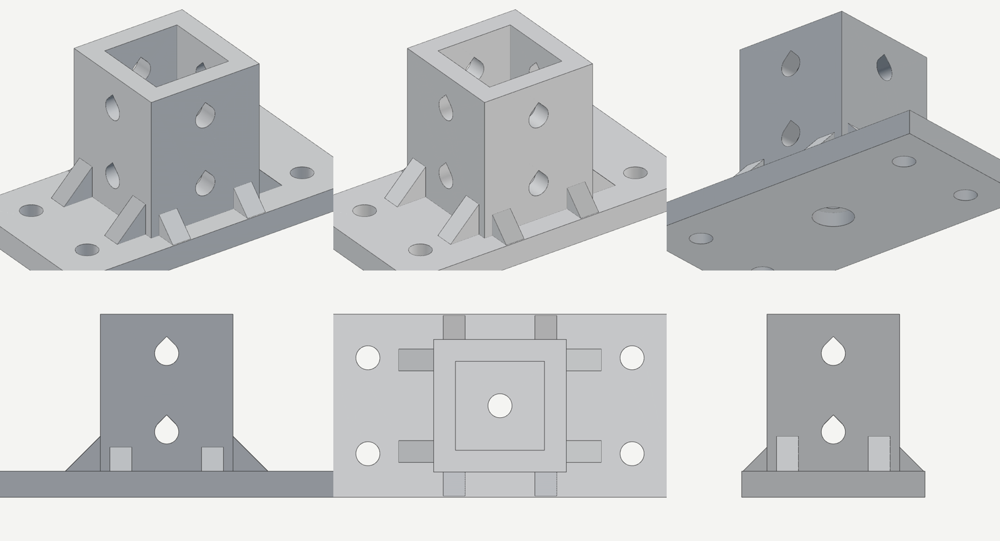

# Hypercube 300 V2 → linear-rail XY

This converts the Hypercube 300 V2 from rods to linear rails. The motors, corner pulleys, belts and hotend position stay the same.

| Axis | Before | After |
|---|---|---|
| Frame top | One Y 2020 per side | A **pair of parallel 2020s per side** (A outboard, B inboard) carried by **one vertical 2020 post per end** through a printed **pair joint**. 4 posts, 4 joints |
| Y | 10 mm rods + LM8LUU | An **MGN12 rail on the inner face of profile A**, with its **MGN12H** carriage facing inboard. The **XY joiner bolts to the carriage and sits between A and B** |
| X | 2 × rods through the carrier | One **2020 beam on top of the two joiners**, with an **MGN9** rail mounted sideways on its **front face**. The carrier bolts to the front of the **MGN9H** |

The carriage and the joiner's mounting plate sit in the 40.5 mm gap between profiles A and B. The joiner's column then rises over profile B (3.5 mm clearance) into the original belt, idler and beam-seat stack. Both belt levels pass under the beam's front edge straight into the carrier's screw clamps, and the space behind the carrier stays free for the part-cooling blower.




## Frame dimensions (for a 300 × 300 mm print area)

All values come from the simulated gantry. X travel = distance between the belt datums − 147.1 mm.

| Measurement | Value |
|---|---|
| Profiles in one pair (A outboard, B inboard) | A is 20 mm wide, then a **40.5 mm gap**, then B (20 mm). **Pair width 80.5 mm** |
| **A to A, centre to centre** | **527 mm** (inner faces 507 mm apart, rails on those faces) |
| **B to B, centre to centre** | **406 mm** (inner faces 386 mm apart) |
| Overall frame width, A outer face to A outer face | 547 mm |
| Belt datum spacing (corner pulleys sit under B) | 448 mm |
| Profile length | **440 mm** × 4 (2 per side, all the same) |
| Post positions | centred under each pair (midway between the outer face of A and the inner face of B), 21 mm in from each profile end (**398 mm apart along Y**) |
| MGN12 rails | **350 mm** × 2, centred on the inner faces of the A profiles, 10 mm below the top face |
| MGN9 rail | **350 mm**, centred on the beam's front face |
| Beam | **472 mm** 2020 (ends 4.5 mm inside the joiners' outer faces) |
| X / Y travel (nozzle) | **300.9 mm / 304.6 mm** |
| Height above the top face of the profiles | carrier top 81.3 mm, beam top 78.3 mm → **leave at least 85 mm free** |
| Depth below the top face | carriage and joiner plate reach 23.5 mm down, between the two profiles of a pair |
| Nozzle tip | 9.35 mm **below** the top face of the profiles |
| Probe offset from the nozzle | X −23.9, Y −1.6 |

Y travel assumes the stationary corner pulleys sit 16 mm in from the front and back ends. If yours sit further in, Y travel drops by the same amount.

**The two sides are not tied together at the top.** The beam and your existing lower frame are the only links between the left and right pairs. I did not add X cross-ties, so brace the base (X profiles between the posts) before relying on the frame for stiffness.

## Printable parts (`stl/`)

Every part is exported **in its print orientation**. `*_installed.stl` are the same parts positioned in machine coordinates.

| File | Qty | Volume | Supports (slicer-style check, `cad/printcheck.py`) |
|---|---|---|---|
| `xy_joiner_left.stl` | 1 | 142 cm³ | **None.** Prints on its outboard (carriage-mounting) face, so that face is dead flat and every layer sits on the one below it. The only flagged spots are crescents under 6 mm² around screw holes in bridged ceilings |
| `xy_joiner_right.stl` | 1 | 142 cm³ | **None** (same as left) |
| `hotend_carrier_mgn9h.stl` | 1 | 54 cm³ | **"Touching build plate" only**, about 7 cm², all under original features: the front half of the probe ring, the blower bracket (a 3 mm gap) and under the groove mount. Nothing new needs support |
| `belt_clamp_cap_x2.stl` | **2** | 3 cm³ | **None** (flat on the bed, toothed face up) |
| `frame_pair_joint_x4.stl` | **4** | 38 cm³ | **None** (plate flat on the bed, collar up, bolt holes are teardrops) |

Printing notes:
- Every horizontal clearance hole is a teardrop, and every new overhang is either a 45° chamfer or a bridge of 25 mm or less.
- Idler B slides in from the inboard face of the joiner, and idler A slides in from the front.
- **Suggested settings:** PETG (ABS/ASA for the carrier), 0.2 mm layers, 4 perimeters, 5 top and bottom layers, 40 % gyroid infill, elephant-foot compensation 0.15 mm.


## The parts

### XY joiners (left and right)


- **Mounting:** a 5 mm plate bolts to the **inboard face of the MGN12H** with 4 × M3×8 (20 × 20 pattern, along X). The screw heads face inboard, with **22.5 mm of open space** in front of them (the gap to profile B) for a hex key. Use M3×8 only: that gives 3 mm of thread in the carriage.
- **Column:** above the plate, a 33 mm wide column clears profile B by 3.5 mm. Two 3 mm ribs stiffen the plate where it hangs below the column.
- **Belt path:** copied exactly from `XY_Joiner_10mm-X_LM8LUU`:
  - Idler A is 21 mm inboard of the old rod axis and 7 mm toward the front. Idler B is 34 mm inboard and 7 mm toward the back.
  - The two belt levels are at the old rod height ±7.25 mm.
  - Pockets are Ø20.5 × 8 mm, sized for 20T GT2 idlers.
  - The straight-through belt tunnel 14.63 mm inboard is kept.
- **Beam seat:** 7 mm thick, with front and rear cheeks holding the beam with 2 × M5 per cheek into T-nuts in its side slots. It has 45° chamfers under the rear overhang, with a gap above the back corner pulley.
- The right joiner is a mirrored copy with the idler levels swapped.
- The thinnest wall is 1.8 mm, the plate's edge under the lower screw holes, which carries no load. Everything else is 2.25 mm or more.

### Hotend carrier



- This is your original `Hypercube300V2_M12_Sensorless_Carrier`, kept at exactly the same position relative to the belts. Nozzle height and the probe offset are unchanged.
- **Rod tubes:** the round lower rod tube is flattened into a flat-faced block that carries the original **rear blower bracket**. The upper tube is removed.
- **Front mount:** a 6 mm plate bolts to the front of the sideways MGN9H with 4 × M3×6 in counterbores, leaving 3 mm of plastic under each head.
- **Belt clamps:** each end is split at the belt plane into a fixed jaw and a removable **clamp cap**.
  - **3 × M3×10 per side** (below the lower belt, between the belts, above the upper belt) go through the cap into heat-set inserts. Tightening them squeezes both belts in GT2 toothed channels (1.25 mm deep against a 1.38 mm belt).
  - The cap fits either side (print 2).
- 45° chamfers sit under the clamp jaws and the plate's front ledge. The side plate continues down to the bed, with a gusset under the probe-ring arm that stops 1 mm short of the probe bore.


### Frame pair joint (print 4)



- **One joint carries both profiles of one side on one vertical 2020.** An 80.5 × 42 × 6 mm plate lies under the ends of A and B, and a 30.4 mm square collar hangs down around the top of the post, with 45° gussets between them.
- **Bolts, 13 per joint (52 in total):**
  - 4 × M5 go up through the plate into T-nuts in the bottom slots of A and B (2 each), accessible from below.
  - 8 × M5 go through the collar into T-nuts in the post's four slots (2 per side).
  - 1 × M5×16 goes down through the plate into the tapped end of the post. Its head sits in a recess in the gap between A and B, so it is reachable from above.
- The joint is mirror-symmetric in both directions, so **one part fits all 4 post positions**.
- The thinnest wall is 2.5 mm. In the simulation the joints touch nothing but the profile undersides and the posts, with 0.000 mm³ of interference.



## Simulated gantry (`cad/simulate.py`)

The simulation assembles:
- the slotted 2020 frame with its posts and 4 pair joints,
- both MGN12 rails with their carriages, on the inner faces of the A profiles,
- the beam with its sideways MGN9 rail and carriage,
- both joiners, the carrier and its clamp caps and screws,
- an E3D-V6 hotend and the M12 probe,
- a 50 × 40 × 57 mm blower space,
- all idlers, and both CoreXY belts routed as true tangent lines between pulleys.

It then searches for the travel limits and checks a 5 × 5 grid of positions inside them.

| Check | Result |
|---|---|
| Part-to-part collisions (all pairs, 25 positions, including the frame and joints) | **none** |
| Belts vs. every part (straight runs and idler wraps) | **none** |
| Blower space vs. joiners, beam and belts | **clear** |
| Belt ends clamped between jaw and cap at the right height (4 ends) | **0.000 mm³ interference** |
| Total belt length across the workspace | constant to **±0.0012 mm** |
| CoreXY kinematics per 10 mm move | belt 1: +ΔX +ΔY, belt 2: −ΔX +ΔY ✔ |
| Largest belt angle off X or Y | 0.59° (inherited from the original idler sizes) |
| X / Y travel | **300.9 / 304.6 mm** |

At the front limit the carriage's leading edge is 3 mm from the end of the front pair joints.


## ⚠ Check these values before printing

These are estimates in `cad/gantry.py → Params`. Change them, then run `python3 cad/build.py` (about 1 s):

| Param | Default | How to check |
|---|---|---|
| `ROD_DZ` | 40.0 | Height from the top face of the profiles to the centre of the old Y rod. This sets the belt heights |
| `ROD_DX` | 0.0 | Sideways offset of the old rod centre from the pulley datum (+ = toward the bed) |
| `LEFT_A_LEVEL` | `"upper"` | On the old **left** joiner, is the idler nearest the front and the frame on the upper belt? |
| `COL_Z0` | 3.5 | Clearance between profile B's top face and the joiner column |

```bash
pip install manifold3d trimesh numpy scipy pillow
python3 cad/build.py                 # writes stl/*.stl
python3 cad/simulate.py [--scenes]   # writes sim/report.json; --scenes also writes per-part STLs
python3 cad/printcheck.py stl/*.stl  # support / bridge check for every part
```

## Hardware

| Qty | Item |
|---|---|
| 2 | MGN12 rail, 350 mm, + MGN12H carriage. The rail mounts on the **inner face** of each A profile, with M3×8 + M3 T-nuts |
| 1 | MGN9 rail, 350 mm, + MGN9H carriage. Mounts sideways in the beam's front slot with M3×8 + M3 T-nuts |
| 4 + 1 | 2020 extrusion: 440 mm × 4 (the pairs), 472 mm × 1 (the beam). The 4 posts are your existing ones |
| 8 | M3×8 SHCS, MGN12H to joiner (**not longer**: 3 mm of thread in the carriage) |
| 2 | M3×18 SHCS, upper idlers (thread into the printed Ø2.8 hole) |
| 2 | M3×20 SHCS, lower idlers (thread into the printed Ø2.8 hole) |
| 8 | M5×10 + M5 T-nuts, joiner cheeks to the beam |
| 4 | M3×6 SHCS, carrier to MGN9H |
| 6 | M3×10 SHCS + 6 M3 heat-set inserts (short, M3×5.7, Ø4.0 hole), belt-clamp caps |
| 48 + 4 | Pair joints: 48 × M5×10 button head + 48 M5 T-nuts (12 per joint), and 4 × M5×16 into the tapped post ends |
| 4 | 20T GT2 idlers (reuse the originals) |

## Assembly order

1. **Frame:**
   - Tap M5 into the top end of each of the 4 posts.
   - Slide 2 T-nuts into each post slot (8 per post) and 2 T-nuts into the bottom slot of each profile (4 per joint).
   - Fit a pair joint on each post, then lay profiles A and B in place on the plate with their bottom-slot bolts loose. Fit the M5×16 into the post end through the gap between A and B.
   - Square the frame, then tighten.
2. **Rails:** mount the MGN12 rails on the inner faces of the A profiles (10 mm below the top, centred), and the MGN9 rail centred on the beam's front face.
3. **Joiners:** from above, bolt each joiner's plate to its MGN12H with the 4 × M3×8, working through the gap to B. Fit the idlers (A from the front, B from the inboard face) and drive their bolts from the top.
4. **Beam:** drop it onto the joiner seats, fit the 8 × M5 cheek bolts loosely, square the gantry, then tighten.
5. **Carrier:** press the 6 heat-set inserts into the jaws. Bolt the carrier to the MGN9H from the front, then fit the hotend, probe and blower.
6. **Belts:** route the belts. At each end, lay both belt ends in their channels with the teeth meshed, tension them, fit the cap and tighten its 3 screws evenly.

The beam covers some of the lower-idler access holes, so do step 3 before step 4.
