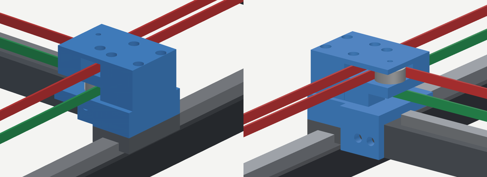
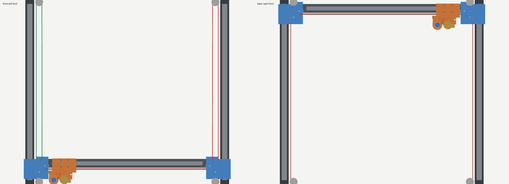

# Hypercube 300 V2 → linear-rail XY

This converts the Hypercube 300 V2 from rods to linear rails. The motors and corner pulleys don't move.

| Axis | Before | After |
|---|---|---|
| Y | 10 mm rods + LM8LUU | **MGN12H** carriage on an MGN12 rail fixed to the top face of each Y 2020 |
| X | 2 × rods + bearing carrier | One **2020** beam with an **MGN9** rail on top; the carrier rides an **MGN9H** |


## Printable parts (`stl/`)

| File | Notes | Volume |
|---|---|---|
| `xy_joiner_left.stl` | Print with the outboard face on the bed | 64.8 cm³ |
| `xy_joiner_right.stl` | Print with the outboard face on the bed; mirror of the left joiner with the idler levels swapped | 65.7 cm³ |
| `hotend_carrier_mgn9h.stl` | Print with the saddle's back face on the bed | 50.2 cm³ |

`*_installed.stl` are the same parts in machine orientation, for CAD or checking fit.
Supports: use "touching build plate + everywhere" with a 60° threshold. Unsupported overhang is about 20 cm² per joiner and about 41 cm² on the carrier.


## What was kept from the originals

The joiner was redrawn from scratch, but every point that sets the belt path is copied from `XY_Joiner_10mm-X_LM8LUU`:

- Idler A is 21 mm inboard of the old Y-rod axis and 7 mm toward the front. Idler B is 34 mm inboard and 7 mm toward the back.
- Idler pockets are Ø20 × 8 mm, sized for 20T GT2 idlers.
- The two belt levels are at the old rod height ±7.25 mm.
- The straight-through belt tunnel 14.63 mm inboard is kept.

Like the original, the outer idler pocket breaks through the inboard face.

The original joiner worked on either side because it was mounted upside down on the right. A rail on the bottom makes that impossible, so the right joiner is a mirrored copy with the idler levels swapped.

The carrier is the original `Hypercube300V2_M12_Sensorless_Carrier` front section. It keeps the E3D groove mount, the M12 probe ring and the side plate, at exactly the same position relative to the belts. Its rod tubes are cut off and the plate is filled flat. New parts added to it:

- An MGN9H saddle (15 × 16 M3 pattern).
- Four belt-clamp channels with GT2 teeth (1.6 mm wide, 7 teeth).

The nozzle-to-probe offset is unchanged: **X −23.9, Y −1.6**.

## Simulated gantry (`cad/simulate.py`)

The simulation assembles the frame, rails, carriages, beam, both joiners, the carrier, an E3D-V6 hotend, the M12 probe, all idlers and both CoreXY belts. Belt runs are calculated as true tangent lines between pulleys. It then searches for the travel limits and checks a 5 × 5 grid of positions inside them.

| Check | Result |
|---|---|
| Part-to-part collisions (all pairs, 25 positions) | **none** |
| Belts vs. every part (straight runs and idler wraps) | **none** |
| Belt end fits its carrier clamp channel at the right height (4 ends) | **0.000 mm³ interference** |
| Total belt length across the workspace | constant to **±0.0016 mm** |
| CoreXY kinematics per 10 mm move | belt 1: +ΔX +ΔY, belt 2: −ΔX +ΔY ✔ |
| Largest belt angle off X or Y | 0.73° (only at the very back, inherited from the original idler sizes) |
| Idlers (Ø18 × 7.6) inside their pockets | clear |
| X travel (carrier) | **292.7 mm** (= rail spacing − 147.3), using a 350 mm MGN9 rail |
| Y travel | **352.7 mm**, limited by the 400 mm MGN12 rail and the front belt run |
| Nozzle height | 9.35 mm below the top face of the Y 2020 (same as before) |






## ⚠ Check these three values, then rebuild

The parts are generated from parameters in `cad/gantry.py → Params`. Three of them are estimates:

| Param | Default | How to check |
|---|---|---|
| `ROD_DZ` | 40.0 | Height from the top face of the Y 2020 to the centre of the old Y rod |
| `ROD_DX` | 0.0 | Sideways offset of the old rod centre from the 2020 centreline (+ = toward the bed) |
| `LEFT_A_LEVEL` | `"upper"` | On the old **left** joiner, is the idler nearest the front and the frame on the upper belt? |
| `Y_RAIL_SPACING` | 440 | Centre-to-centre distance between the rails. Used only for the beam length and the travel figures |

```bash
pip install manifold3d trimesh numpy scipy
python3 cad/build.py      # writes stl/*.stl (~1 s)
python3 cad/simulate.py   # writes sim/report.json (~6 s)
```

## Hardware (per machine)

| Qty | Item |
|---|---|
| 2 | MGN12 rail 400 mm + MGN12H carriage; M3×8 + M3 T-nuts to mount the rail on the 2020 |
| 1 | MGN9 rail 350 mm + MGN9H carriage; M3×8 + M3 T-nuts |
| 1 | 2020 extrusion, length = `Y_RAIL_SPACING − 39` (401 mm at the default) |
| 8 | M3×8 SHCS, carriage to joiner. The heads sit at the bottom of Ø6.5 shafts, so use a long ball-end hex key |
| 4 | M3×8 SHCS, MGN9H to carrier |
| 2 + 2 | M3×16 for the upper idlers and M3×20 for the lower idlers. Both thread into tapped Ø2.8 holes |
| 4 | M5×10 + M5 T-nuts, joiner cheeks to the front and back slots of the beam (lets you square the gantry) |
| 4 | 20T GT2 idlers, reused |

Notes:

- The belt teeth face away from y = 0 in the clamps. Push the belt in, tension it, and add a zip tie through the open slot if you want extra security.
- The original carrier's rear bracket, which hung behind the rods, and its top tab were dropped because they would hit the beam.
- The carrier STL keeps 23 non-manifold edges that were already in the source file. Slicers repair them automatically.
