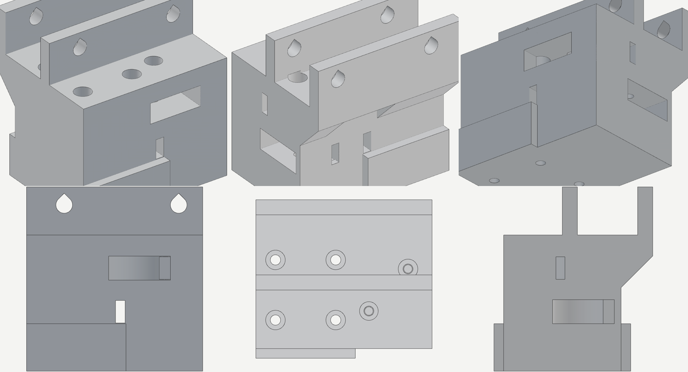
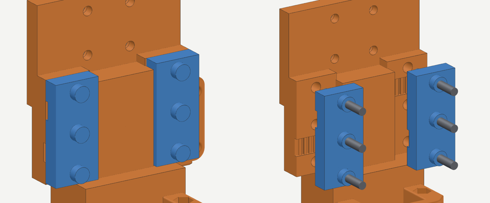
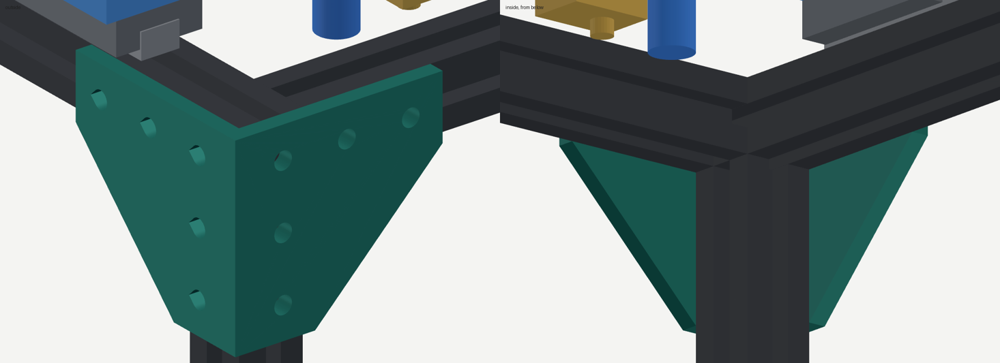
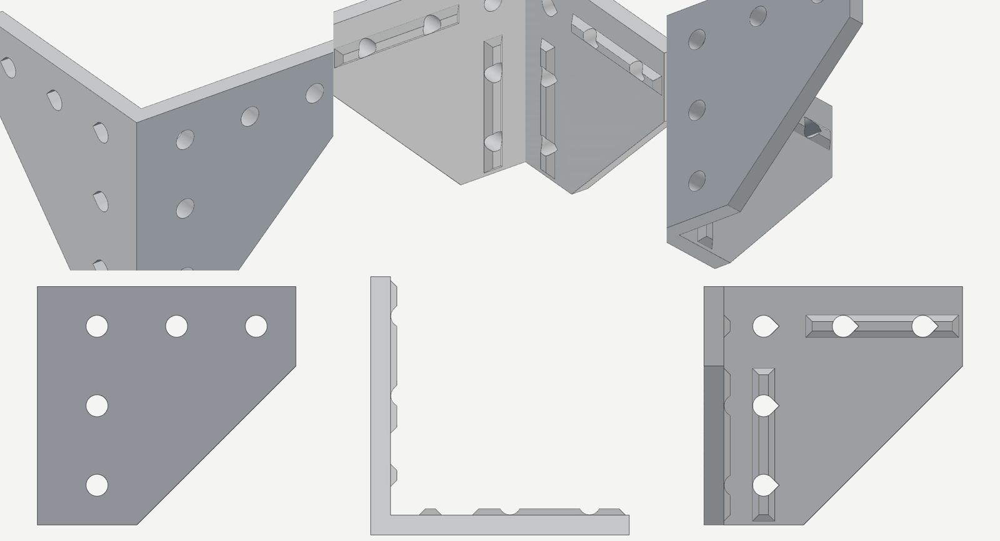
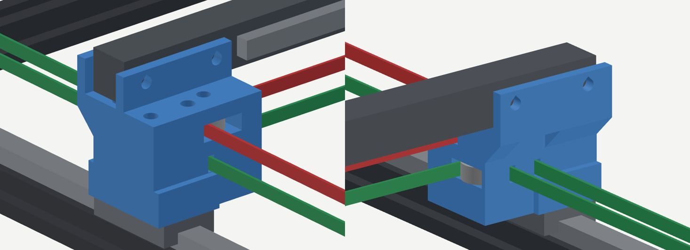

# Hypercube 300 V2 → linear-rail XY

This converts the Hypercube 300 V2 from rods to linear rails. The motors, corner pulleys, belts and hotend position stay the same.

| Axis | Before | After |
|---|---|---|
| Y | 10 mm rods + LM8LUU | **MGN12H** carriage on an MGN12 rail fixed to the top face of each Y 2020 |
| X | 2 × rods through the carrier | One **2020 beam on top of the two joiners**, with an **MGN9** rail mounted sideways on its **front face**. The carrier bolts to the front of the **MGN9H** |
| Frame top | — | The Y 2020s run over 4 vertical posts; the X 2020s butt between them. A printed **corner joint** is fitted at every corner |

The beam sits above both belt levels and is set 15 mm behind the joiner centre. Both belt levels pass under its front edge straight into the carrier's screw clamps. The space behind the carrier below the beam stays free for the part-cooling blower.


## Frame dimensions (for a 300 × 300 mm print area)

All values come from the simulated gantry. X travel = Y-rail spacing − 147.1 mm.

| Measurement | Value |
|---|---|
| **Distance between the two Y 2020s**, centre to centre | **448 mm** (the gap between them is 428 mm; the outside width is 468 mm) |
| Inside length between the front and back X 2020s | **400 mm** |
| Y 2020 length (runs over the posts) | **440 mm** × 2 |
| X 2020 length (butts between the Y 2020s) | **428 mm** × 2 |
| X beam 2020 length | **472 mm** (ends 4.5 mm inside the joiners' outer faces) |
| MGN12 rails | **350 mm** × 2, centred on the Y 2020s |
| MGN9 rail | **350 mm**, centred on the beam's front face |
| X / Y travel (nozzle) | **300.9 mm / 304.6 mm** |
| Height of the gantry above the top face of the Y 2020 | carrier top 81.3 mm, beam top 78.3 mm, joiner cheeks 74.3 mm → **leave at least 85 mm of clearance** above the Y 2020s |
| Nozzle tip | 9.35 mm **below** the top face of the Y 2020 |
| Bed centre (under the nozzle's travel centre) | X 227.8 mm from the left Y-rail centre (3.8 mm right of the frame centre); Y 176.9 mm from the inside face of the front X 2020 (23.1 mm in front of the frame centre) |
| Probe offset from the nozzle | X −23.9, Y −1.6 |

Y travel assumes the stationary corner pulleys sit 16 mm in from the inside faces of the front and back X 2020s. If yours sit further in, Y travel drops by the same amount.

## Printable parts (`stl/`)

Every part is exported **in its print orientation, already oriented for printing**. `*_installed.stl` are the same parts positioned in machine coordinates.

| File | Qty | Volume | Supports (slicer-style check, `cad/printcheck.py`) |
|---|---|---|---|
| `xy_joiner_left.stl` | 1 | 106 cm³ | **None.** All ceilings are bridges of 25 mm or less. The only flagged areas are under-7 mm² crescents around screw holes in bridged ceilings, which slicers bridge normally |
| `xy_joiner_right.stl` | 1 | 106 cm³ | **None** (same as left) |
| `hotend_carrier_mgn9h.stl` | 1 | 54 cm³ | **"Touching build plate" only**, about 7 cm², all under original features: the front half of the probe ring, the blower bracket (a 3 mm gap) and under the groove mount. Nothing new needs support |
| `belt_clamp_cap_x2.stl` | **2** | 3 cm³ | **None** (flat on the bed, toothed face up) |
| `frame_corner_joint_x4.stl` | **4** | 29 cm³ | **None** (one plate flat on the bed; holes in the standing plate are teardrops) |

How the parts were made easy to print:
- All parts except the corner joint print upright, the way they're installed. Belt tension and idler loads then run along the layers.
- Every horizontal clearance hole is a teardrop.
- Every overhang that belongs to the new geometry is either a 45° chamfer or a bridge of 25 mm or less between two walls.
- The joiners print flat on their MGN12H mounting face, with 25 cm² of bed contact. Idler B (the outer one, whose pocket breaks through the inner face) now slides in from the inboard face, so the ceiling over it is a bridge rather than a cantilever.

**Suggested print settings:**
- Material: PETG, or ABS/ASA for the carrier.
- 0.2 mm layers, 4 perimeters, 5 top and bottom layers, 40 % gyroid infill.
- Elephant-foot compensation 0.15 mm.


## The parts

### XY joiners (left and right)



- The body is 33 mm wide and sits on the MGN12H with 4 × M3×8. The screw heads are at the bottom of Ø6.5 shafts.
- Belt-path geometry is copied exactly from `XY_Joiner_10mm-X_LM8LUU`:
  - Idler A is 21 mm inboard of the old rod axis and 7 mm toward the front. Idler B is 34 mm inboard and 7 mm toward the back.
  - The two belt levels are at the old rod height ±7.25 mm.
  - Pockets are Ø20.5 × 8 mm, sized for 20T GT2 idlers.
  - The straight-through belt tunnel 14.63 mm inboard is kept.
- Idler insertion: idler A slides in from the front; idler B slides in from the inboard face.
- On top is a 7 mm beam seat with front and rear cheeks, holding the beam with 2 × M5 per cheek into T-nuts in its side slots. The seat's rear overhang has 45° chamfers, with a gap left above the back corner pulley.
- The right joiner is a mirrored copy with the idler levels swapped.
- The thinnest wall anywhere is **2.25 mm** (full wall-thickness scan).

### Hotend carrier


- This is your original `Hypercube300V2_M12_Sensorless_Carrier`, kept at exactly the same position relative to the belts. Nozzle height and the probe offset are unchanged.
- **Rod tubes:** the round lower rod tube is flattened into a flat-faced block. That block carries the original **rear blower bracket** and steps down under the clamps. The upper tube is removed.
- **Front mount:** a 6 mm plate bolts to the front of the sideways MGN9H with 4 × M3×6 in counterbores, leaving 3 mm of plastic under each head.
- **Belt clamps:** each end is split at the belt plane into a fixed jaw and a removable **clamp cap**.
  - **3 × M3×10 per side** (below the lower belt, between the belts, above the upper belt) go through the cap into heat-set inserts. Tightening them squeezes both belts in GT2 toothed channels: 1.25 mm deep against a 1.38 mm belt.
  - The cap fits either side (print 2).
- **Printability and stiffness:**
  - 45° chamfers under the clamp jaws and the plate's front ledge.
  - The side plate now continues down to the bed.
  - A 45° gusset sits under the probe-ring arm, stopping 1 mm short of the probe bore.



### Frame corner joint (print 4)



- Two 5 mm plates wrap the corner's two **outer** faces. Each has a 60 mm arm along a horizontal profile and a 40 mm leg down the post, joined by a 45° gusset edge.
- Nothing sits inside the frame or above the top faces, so the Y rails, joiners, belts, motors and Z hardware stay clear.
- **Tapered keys** (5.6 mm wide at the root, 45° sides) drop into the slot openings, so the joint centres itself and squares the corner.
- **10 × M5 per joint:** 9 go into T-nuts, and 1 goes into the tapped M5 end of the profile that runs over the post.
- The joint is mirror-symmetric across its diagonal, so **one part fits all 4 corners**.
- In the simulation, every key sits inside a slot opening with zero interference, on all 4 corners.



## Simulated gantry (`cad/simulate.py`)

The simulation assembles:
- the slotted 2020 frame with its posts and the 4 corner joints,
- both MGN12 rails with their carriages,
- the beam with its sideways MGN9 rail and carriage,
- both joiners, the carrier and its clamp caps and screws,
- an E3D-V6 hotend and the M12 probe,
- a 50 × 40 × 57 mm blower space,
- all idlers, and both CoreXY belts routed as true tangent lines between pulleys.

It then searches for the travel limits and checks a 5 × 5 grid of positions inside them.

| Check | Result |
|---|---|
| Part-to-part collisions (all pairs, 25 positions, including the frame joints) | **none** |
| Belts vs. every part (straight runs and idler wraps) | **none** |
| Blower space vs. joiners, beam and belts | **clear** |
| Belt ends clamped between jaw and cap at the right height (4 ends) | **0.000 mm³ interference** |
| Corner-joint keys in the slot openings | **0.000 mm³ interference** |
| Total belt length across the workspace | constant to **±0.0012 mm** |
| CoreXY kinematics per 10 mm move | belt 1: +ΔX +ΔY, belt 2: −ΔX +ΔY ✔ |
| Largest belt angle off X or Y | 0.59° (inherited from the original idler sizes) |
| X / Y travel | **300.9 / 304.6 mm** |




## ⚠ Check these values before printing

These are estimates in `cad/gantry.py → Params`. Change them, then run `python3 cad/build.py` (about 1 s):

| Param | Default | How to check |
|---|---|---|
| `ROD_DZ` | 40.0 | Height from the top face of the Y 2020 to the centre of the old Y rod. This sets the belt heights |
| `ROD_DX` | 0.0 | Sideways offset of the old rod centre from the 2020 centreline (+ = toward the bed) |
| `LEFT_A_LEVEL` | `"upper"` | On the old **left** joiner, is the idler nearest the front and the frame on the upper belt? |

The frame values (`Y_RAIL_SPACING` 448, `FRAME_Y_INNER` 400, `Y_RAIL_LEN` 350) are set for a 300 × 300 mm print area.

```bash
pip install manifold3d trimesh numpy scipy pillow
python3 cad/build.py                 # writes stl/*.stl
python3 cad/simulate.py [--scenes]   # writes sim/report.json; --scenes also writes per-part STLs
python3 cad/printcheck.py stl/*.stl  # support / bridge check for every part
```

## Hardware

| Qty | Item |
|---|---|
| 2 | MGN12 rail, 350 mm, + MGN12H carriage. Mount on the Y 2020 top slots with M3×8 + M3 T-nuts |
| 1 | MGN9 rail, 350 mm, + MGN9H carriage. Mount sideways in the beam's front slot with M3×8 + M3 T-nuts |
| 2 + 2 + 1 | 2020 extrusion: 440 mm (Y) × 2, 428 mm (X) × 2, 472 mm (beam) × 1. The posts are your existing ones |
| 8 | M3×8 SHCS, MGN12H to joiner |
| 2 | M3×18 SHCS, upper idlers (thread into the printed Ø2.8 hole) |
| 2 | M3×20 SHCS, lower idlers (thread into the printed Ø2.8 hole) |
| 8 | M5×10 + M5 T-nuts, joiner cheeks to the beam |
| 4 | M3×6 SHCS, carrier to MGN9H |
| 6 | M3×10 SHCS + 6 M3 heat-set inserts (short, M3×5.7, Ø4.0 hole), belt-clamp caps |
| 36 + 4 | Corner joints: 36 × M5×10 button head + M5 T-nuts, and 4 × M5×12 into the tapped profile ends |
| 4 | 20T GT2 idlers (reuse the originals) |

## Assembly order

1. **Frame:**
   - Tap M5 into the front and back ends of both Y 2020s.
   - Stand the 4 posts and lay each Y 2020 over its two posts.
   - Put the X 2020s between the Y 2020s.
   - Fit a corner joint on each corner with its keys in the slots, using T-nuts plus one M5×12 into the Y 2020's end. Tighten while the frame is square.
2. Mount the MGN12 rails centred on the Y 2020 top faces, and the MGN9 rail centred on the beam's front face.
3. **Joiners:** bolt each joiner to its MGN12H. Fit the idlers (A from the front, B from the inboard face) and drive their bolts from the top.
4. **Beam:** drop it onto the joiner seats, fit the 8 × M5 cheek bolts loosely, square the gantry, then tighten.
5. **Carrier:** press the 6 heat-set inserts into the jaws. Bolt the carrier to the MGN9H from the front, then fit the hotend, probe and blower.
6. **Belts:** route the belts. At each end, lay both belt ends in their channels with the teeth meshed, tension them, fit the cap and tighten its 3 screws evenly.

The beam covers some of the MGN12H screw shafts and the lower-idler access holes, so do step 3 before step 4.
