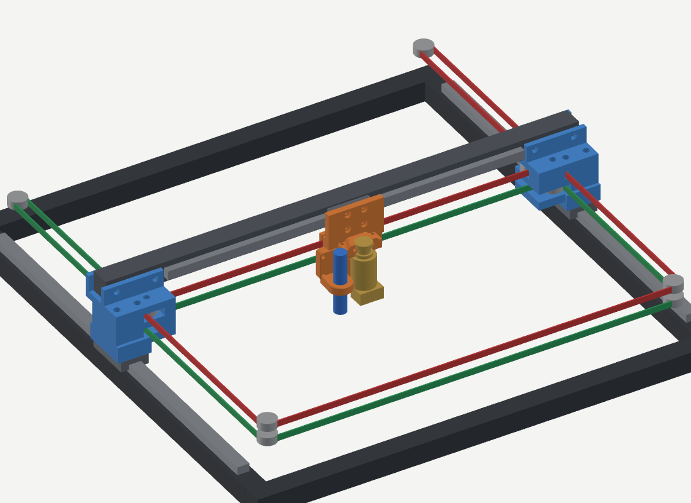
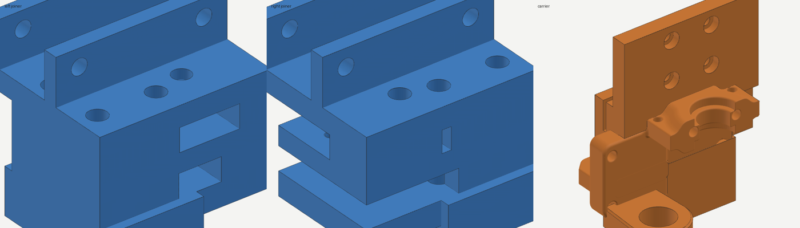
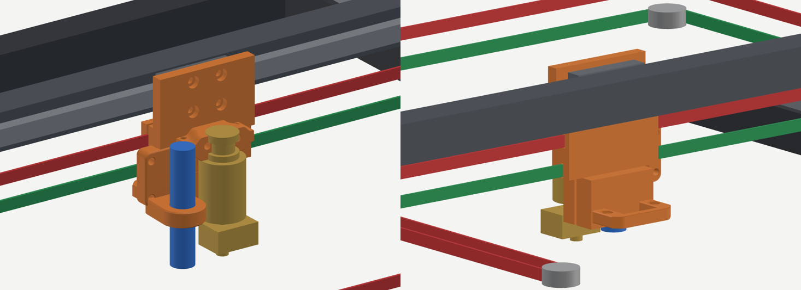

# Hypercube 300 V2 → linear-rail XY

This converts the Hypercube 300 V2 from rods to linear rails. The motors, corner pulleys, belts and hotend position stay the same.

| Axis | Before | After |
|---|---|---|
| Y | 10 mm rods + LM8LUU | **MGN12H** carriage on an MGN12 rail fixed to the top face of each Y 2020 |
| X | 2 × rods through the carrier | One **2020 beam on top of the two joiners**, with an **MGN9** rail mounted sideways on its **front face**. The carrier bolts to the front of the **MGN9H** |

The beam sits above both belt levels and is set 15 mm behind the joiner centre. Both belt levels pass under its front edge straight into the carrier's clamps. The space behind the carrier below the beam stays free for the part-cooling blower.



## Printable parts (`stl/`)

All parts are exported in **print orientation, which is the same as installed orientation**. In that orientation belt tension and idler loads always run along the layers, never across them, and each joiner's MGN12H face prints flat on the bed.

| File | Volume | Overhang (needs support) |
|---|---|---|
| `xy_joiner_left.stl` | 92.7 cm³ | 32 cm², mostly short bridges over the idler pockets |
| `xy_joiner_right.stl` | 92.0 cm³ | 33 cm² |
| `hotend_carrier_mgn9h.stl` | 56.2 cm³ | 17 cm² |

`*_installed.stl` are the same parts positioned in machine coordinates, for CAD or checking fit.

**Suggested print settings:**
- Material: PETG at minimum for the carrier; ABS or ASA are better near the hotend.
- 4 perimeters, 5 top and bottom layers, 40 % gyroid infill.
- Supports touching the build plate only.



## The parts

### XY joiners (left and right)


- The body is 33 mm wide and sits on the MGN12H with 4 × M3×8. The screw heads are at the bottom of Ø6.5 shafts.
- Belt-path geometry is copied exactly from `XY_Joiner_10mm-X_LM8LUU`:
  - Idler A is 21 mm inboard of the old rod axis and 7 mm toward the front. Idler B is 34 mm inboard and 7 mm toward the back.
  - The two belt levels are at the old rod height ±7.25 mm.
  - Pockets are Ø20.5 × 8 mm, sized for 20T GT2 idlers.
  - The straight-through belt tunnel 14.63 mm inboard is kept.
- The original joiner fitted either side because it was flipped upside down on the right. A rail underneath makes that impossible, so the right joiner is a mirrored copy with the idler levels swapped.
- On top is a 7 mm beam seat with front and rear cheeks. These clamp the beam with 2 × M5 per cheek into T-nuts in the beam's side slots, which also lets you square the gantry.
- The upper idler bolt head is recessed with 3.5 mm of material under it, so the beam sits flat.
- The thinnest wall anywhere is **2.75 mm** (full wall-thickness scan).

### Hotend carrier


- This is your original `Hypercube300V2_M12_Sensorless_Carrier`, kept at exactly the same position relative to the belts. Nozzle height and the probe offset (**X −23.9, Y −1.6**) are unchanged.
- **The old rod tube is flattened.** The round lower tube is cut away and replaced by a flat-faced block of the same footprint. That block carries the original **rear blower bracket** and runs up into the belt-clamp block. The upper tube is removed entirely.
- **Front mount:** a 6 mm plate rises in front of the beam and bolts to the front of the sideways MGN9H with 4 × M3×6. The heads are counterbored, leaving 3 mm under each. The plate overlaps the clamp block by 9 mm.
- **Belt clamps:** four GT2 toothed channels, 1.6 mm wide with 7 teeth, with at least 3 mm of wall behind each.
  - Upper belts drop in from the top; lower belts load from below.
  - Pull the belt tight, push it into the teeth, and add a zip tie if you like.
- The only walls under 1 mm are inside the original groove-mount clamp detail, unchanged from your current part.

## Simulated gantry (`cad/simulate.py`)

The simulation assembles:
- the frame and both MGN12 rails with their carriages,
- the beam with its sideways MGN9 rail and carriage,
- both joiners and the carrier,
- an E3D-V6 hotend and the M12 probe,
- a 50 × 45.5 × 54 mm blower space,
- all idlers, and both CoreXY belts routed as true tangent lines between pulleys.

It then searches for the travel limits and checks a 5 × 5 grid of positions inside them.

| Check | Result |
|---|---|
| Part-to-part collisions (all pairs, 25 positions) | **none** |
| Belts vs. every part (straight runs and idler wraps) | **none** |
| Blower space vs. joiners, beam and belts | **clear** |
| Belt ends fit their clamp channels at the right height (4 ends) | **0.000 mm³ interference** |
| Total belt length across the workspace | constant to **±0.0015 mm** |
| CoreXY kinematics per 10 mm move | belt 1: +ΔX +ΔY, belt 2: −ΔX +ΔY ✔ |
| Largest belt angle off X or Y | 0.68° (only at the very back, inherited from the original idler sizes) |
| X travel | **293.3 mm** (= rail spacing − 146.7) |
| Y travel | **351.0 mm** |
| Nozzle height | 9.35 mm below the top face of the Y 2020 (same as before) |
| Top of gantry | carrier plate at 81.3 mm above the Y 2020, about the same as the old carrier (80.7 mm) |





## ⚠ Check these values, then rebuild

The parts are generated from parameters in `cad/gantry.py → Params`. These are estimates:

| Param | Default | How to check |
|---|---|---|
| `ROD_DZ` | 40.0 | Height from the top face of the Y 2020 to the centre of the old Y rod |
| `ROD_DX` | 0.0 | Sideways offset of the old rod centre from the 2020 centreline (+ = toward the bed) |
| `LEFT_A_LEVEL` | `"upper"` | On the old **left** joiner, is the idler nearest the front and the frame on the upper belt? |
| `Y_RAIL_SPACING` | 440 | Centre-to-centre distance between the Y rails. Used for the beam length and the travel figures |

```bash
pip install manifold3d trimesh numpy scipy
python3 cad/build.py               # writes stl/*.stl (~1 s)
python3 cad/simulate.py [--scenes] # writes sim/report.json (~6 s); --scenes also writes per-part STLs
```

## Hardware

| Qty | Item |
|---|---|
| 2 | MGN12 rail, 400 mm, + MGN12H carriage. Mount on the Y 2020 top slots with M3×8 + M3 T-nuts |
| 1 | MGN9 rail, 350 mm, + MGN9H carriage. Mount sideways in the beam's front slot with M3×8 + M3 T-nuts |
| 1 | 2020 extrusion, length = `Y_RAIL_SPACING + 24` (464 mm at the default); ends flush 4.5 mm inside the joiners' outer faces |
| 8 | M3×8 SHCS, MGN12H to joiner |
| 2 | M3×18 SHCS, upper idlers (thread into the printed Ø2.8 hole) |
| 2 | M3×20 SHCS, lower idlers (thread into the printed Ø2.8 hole) |
| 8 | M5×10 + M5 T-nuts, joiner cheeks to the beam (the front-slot T-nuts share the slot with the rail, outside its ends) |
| 4 | M3×6 SHCS, carrier to MGN9H |
| 4 | 20T GT2 idlers (reuse the originals) |

## Assembly order

1. Mount the MGN12 rails on the Y 2020s, and the MGN9 rail on the beam's front face (centred).
2. Bolt each joiner to its MGN12H. Fit its idlers: put the stack into the pocket from the side, then drive the bolt from the top.
3. Drop the beam onto the joiner seats. Loosely fit the 8 × M5 cheek bolts, square the gantry, then tighten.
4. Bolt the carrier to the MGN9H from the front, and fit the hotend, probe and blower.
5. Route the belts as before. Clamp the upper ends from the top and the lower ends from below, then tension.

Note: the beam covers some of the MGN12H screw shafts and the lower-idler access holes, so do steps 2 and 3 in that order.
